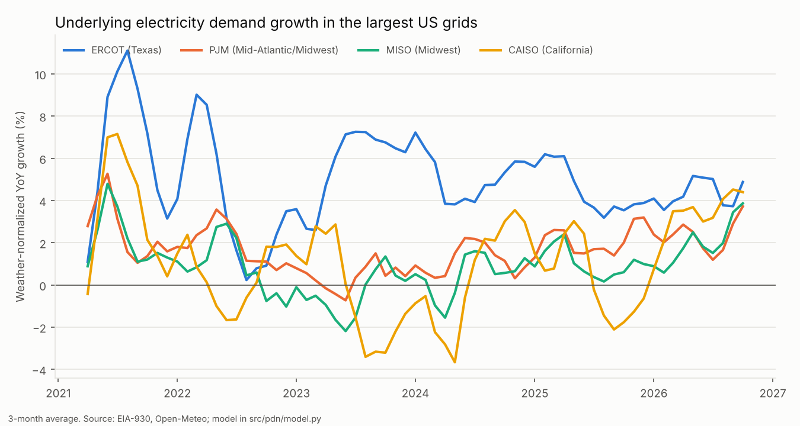
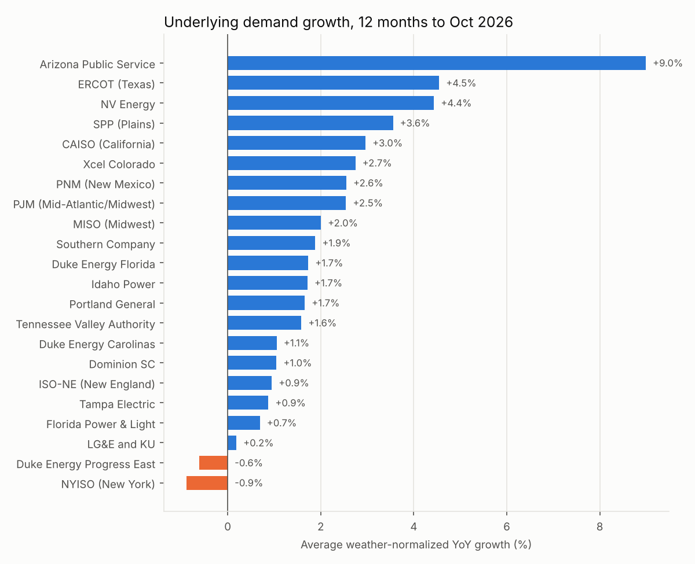
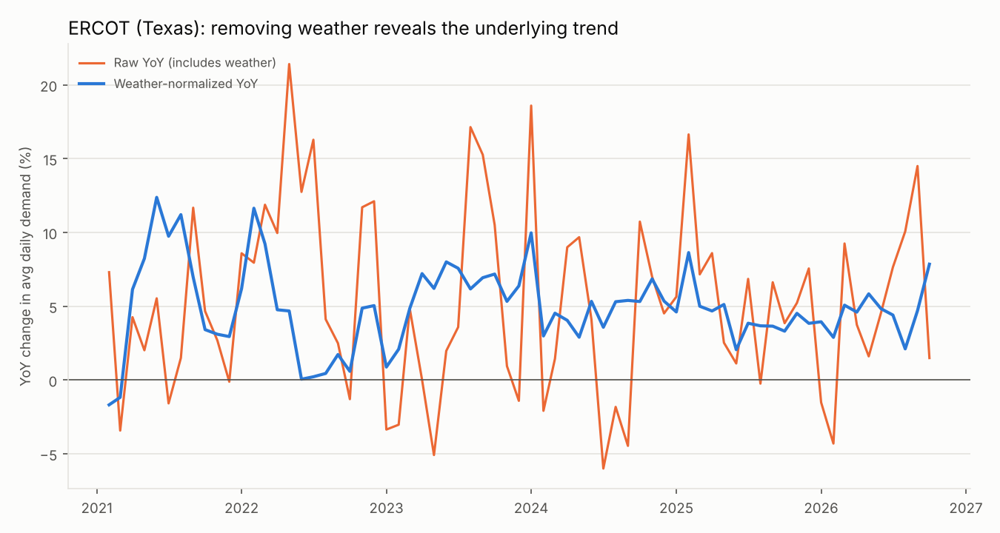

# Power Demand Nowcasting

**Weather-normalized electricity demand for 22 US grids, built from free public data, as the signal engine for a study of grid tightness and power-exposed equities.**

Electricity demand is the most direct real-time read on the US power story (data centers, electrification, onshoring). Raw demand is mostly noise from weather, though. A hot July can look like 15% growth, and a mild one can look like a decline. This project strips out weather and calendar effects from hourly grid data to estimate **underlying demand growth** by region, using only information available at each point in time.



## Key results so far (week 1)



- **Arizona Public Service (+9.0%), ERCOT (+4.5%) and NV Energy (+4.4%)** show the fastest weather-normalized growth over the 12 months to Oct 2026. NYISO and Duke Energy Progress East are flat to slightly down.
- Removing weather changes the picture a lot. In ERCOT, raw year-over-year demand swings between −6% and +21%, while the weather-normalized series stays in a much tighter band:



- **Out-of-sample accuracy:** we forecast each month's average daily demand from realized weather and a level carried forward from earlier months. The mean absolute monthly error is **1.3% to 3.0%** across grids (PJM 1.3%, ERCOT 2.0%). See [`reports/accuracy_by_ba.csv`](reports/accuracy_by_ba.csv).

## Method

For each balancing authority (BA), daily demand is modeled as

```
log(MWh_d) = f(weather_d, calendar_d) + α_month(d) + ε_d
```

- **f** is piecewise-linear in population-weighted daily temperature (hinges at 35/45/55/65°F for heating and 65/72/80/88°F for cooling). It also includes afternoon-peak and overnight-cold terms, yesterday's degree days (thermal inertia), a summer cooling interaction, day of week, and US federal holidays.
- **α_m** is a separate level for each calendar month: the demand left over once weather and calendar are removed. Weather-normalized YoY growth is `exp(α_m − α_{m−12}) − 1`.
- Estimation is OLS with month fixed effects, done by within-month demeaning. Gross outliers (more than 5σ, from bad EIA hours) are dropped and the model is refit, and month levels use the median residual.

**No look-ahead.** The weather and calendar coefficients used for month *m* are estimated only on data **before** month *m* begins (an expanding window, refit every month). The accuracy test forecasts month *m* with `α̂_m = α_{m−12} + (α_{m−1} − α_{m−13})`, which uses only past months.

### Honest caveats
- **Data revisions:** EIA-930 bulk files are the *latest vintage*, and EIA and the BAs revise history. A true real-time backtest would need archived snapshots. The model uses EIA's anomaly-adjusted demand series.
- **Weather is approximate:** each BA's temperature is a fixed-weight average of 1 to 5 metro points, a simplification of true load-weighted weather.
- **Not an operational forecast:** day to day, the grid operators' own day-ahead forecasts are more accurate (they model hourly load with far richer inputs). The goal here is to break monthly demand into weather and underlying growth, which those forecasts don't provide.
- **2021 base effects:** YoY growth in early 2021 compares against the COVID-depressed 2020, so ignore that stretch.

## Data (all free, no API keys)

| Source | What | Link |
|---|---|---|
| EIA-930 Hourly Electric Grid Monitor | Hourly demand and day-ahead demand forecast by BA, 2019 to present | https://www.eia.gov/electricity/gridmonitor/ |
| Open-Meteo Historical Weather API | Hourly 2m temperature (ERA5 reanalysis) | https://open-meteo.com/en/docs/historical-weather-api |

## Reproduce

```bash
pip install -r requirements.txt
python scripts/01_download.py        # about 10 min: EIA-930 bulk files and weather for about 50 points
python scripts/02_build_and_fit.py   # daily panel, point-in-time model, figures and CSVs
```

Outputs: `reports/monthly_levels.csv` (α, weather-normalized and raw YoY by BA-month), `reports/accuracy_by_ba.csv`, `reports/figures/`.

## Repo layout

```
src/pdn/config.py     BA universe, weather points, time zones
src/pdn/eia930.py     EIA-930 download and tidy
src/pdn/weather.py    Open-Meteo download, population-weighted temperature
src/pdn/features.py   local-day demand, degree days, calendar
src/pdn/model.py      point-in-time weather-normalization model
src/pdn/plots.py      README figures
scripts/              pipeline entry points
```

## Roadmap

- [x] **Week 1:** data pipeline and weather-normalized demand model for 22 BAs
- [ ] **Week 2:** validate the nowcast against EIA-861M monthly utility sales; map BAs to listed utilities and run an earnings event study
- [ ] **Week 3:** grid-tightness index (PJM and ERCOT congestion, capacity auctions, LBNL interconnection queues), firm exposure from EIA-860, return tests, research note and project website
