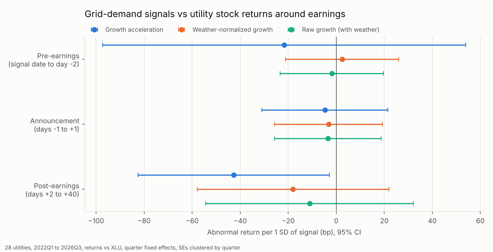

# Power Demand Nowcasting

**Weather-normalized electricity demand for 22 US grids plus PJM's Dominion zone (Northern Virginia), built from free public data, as the signal engine for a study of grid tightness and power-exposed equities.**

Electricity demand is the most direct real-time read on the US power story (data centers, electrification, onshoring). Raw demand is mostly noise from weather, though. A hot July can look like 15% growth, and a mild one can look like a decline. This project strips out weather and calendar effects from hourly grid data to estimate **underlying demand growth** by region, using only information available at each point in time.


## Key results so far


- **Arizona Public Service (+9.0%), the Dominion zone in Northern Virginia (+7.8%), ERCOT (+4.5%) and NV Energy (+4.4%)** show the fastest weather-normalized growth over the 12 months to Oct 2026. NYISO and Duke Energy Progress East are flat to slightly down.
- Removing weather changes the picture a lot. In ERCOT, raw year-over-year demand swings between −6% and +21%, while the weather-normalized series stays in a much tighter band:


- **Out-of-sample accuracy:** we forecast each month's average daily demand from realized weather and a level carried forward from earlier months. The mean absolute monthly error is **1.3% to 3.0%** across grids (PJM 1.3%, ERCOT 2.0%). See [`reports/accuracy_by_ba.csv`](reports/accuracy_by_ba.csv).

## Do grid-demand nowcasts move utility stocks? (event study)



**Short answer: not at earnings.** Across 28 listed utilities and 531 earnings events (2022Q1 to 2026Q3), weather-normalized demand growth does not predict abnormal returns before or at the announcement. One result is worth a follow-up but is not yet evidence: growth *acceleration* has a negative relation with returns over the 40 trading days after earnings.

| Window | Signal: growth acceleration | 95% CI | p |
|---|---|---|---|
| Pre-earnings (signal date to day −2, about 17 sessions) | −22 bp per SD | −97 to +54 | 0.57 |
| Announcement (days −1 to +1) | −5 bp per SD | −31 to +22 | 0.73 |
| Post-earnings (days +2 to +40) | −43 bp per SD | −82 to −3 | 0.04 |

Full results for all three signals are in [`reports/event_study_results.csv`](reports/event_study_results.csv), and robustness checks in [`reports/event_study_robustness.csv`](reports/event_study_robustness.csv).

**Design**
- **Universe and exposure:** 28 US utilities, each mapped to the grids it serves with fixed load-share weights (for example Dominion = 80% DOM zone + 20% Dominion SC; Xcel = 45% MISO, 35% Colorado, 20% SPP). See `src/pdn/equities.py`.
- **Signals per company-quarter:** *growth* = exposure-weighted weather-normalized YoY growth over the quarter. *Acceleration* = growth minus its trailing 4-quarter average. *Raw* = growth including weather, used as a placebo.
- **Timing:** each quarter's signal is treated as public 7 days after quarter end, allowing for the EIA-930 and weather data lags. Earnings dates are the first SEC 8-K with Item 2.02 filed 14 to 80 days after quarter end. Day 0 is the first session after the filing's acceptance time, so filings after 4 PM ET roll to the next day.
- **Returns:** log returns in excess of β × XLU (the utilities ETF), with β estimated over days −250 to −30.
- **Test:** pooled OLS of CAR on the signal, standardized within each quarter, with quarter fixed effects (a pure cross-sectional test) and standard errors clustered by quarter.

**How to read it**
- **The power is limited but real.** The announcement test could detect an effect of about ±25 bp per SD. A typical 3-day utility earnings move has a standard deviation of about 250 bp, so a demand signal worth trading on would have shown up.
- **This makes economic sense.** Regulated utilities earn on rate base, not volume. Rate cases, capex plans and decoupling mechanisms blunt the link from sales to earnings, and sell-side models already include weather-adjusted sales guidance.
- **Treat the post-earnings result with caution.** It is 1 of 9 tests, so it fails a Bonferroni correction (needs p < 0.0056). Its sign is the opposite of a naive "more demand is good" story. A plausible reading is that high-growth territories carry more capex and rate-case risk, or that it reflects exposure to the AI/data-center trade. It holds up with winsorized returns and without 2024Q4. That quarter matters because the January 2025 Los Angeles wildfires crashed EIX and PCG inside the pre-earnings window, and that one quarter drives the wide pre-earnings interval. The next step is to test it on fresh data, not to keep re-tuning it.

## Method

For each balancing authority (BA), daily demand is modeled as

```
log(MWh_d) = f(weather_d, calendar_d) + α_month(d) + ε_d
```

- **f** is piecewise-linear in population-weighted daily temperature (hinges at 35/45/55/65°F for heating and 65/72/80/88°F for cooling). It also includes afternoon-peak and overnight-cold terms, yesterday's degree days (thermal inertia), a summer cooling interaction, day of week, and US federal holidays.
- **α_m** is a separate level for each calendar month: the demand left over once weather and calendar are removed. Weather-normalized YoY growth is `exp(α_m − α_{m−12}) − 1`.
- Estimation is OLS with month fixed effects, done by within-month demeaning. Gross outliers (more than 5σ, from bad EIA hours) are dropped and the model is refit, and month levels use the median residual.

**No look-ahead.** The weather and calendar coefficients used for month *m* are estimated only on data **before** month *m* begins (an expanding window, refit every month). The accuracy test forecasts month *m* with `α̂_m = α_{m−12} + (α_{m−1} − α_{m−13})`, which uses only past months.

### Honest caveats
- **Data revisions:** EIA-930 bulk files are the *latest vintage*, and EIA and the BAs revise history. A true real-time backtest would need archived snapshots. The model uses EIA's anomaly-adjusted demand series.
- **Weather is approximate:** each BA's temperature is a fixed-weight average of 1 to 5 metro points, a simplification of true load-weighted weather.
- **Not an operational forecast:** day to day, the grid operators' own day-ahead forecasts are more accurate (they model hourly load with far richer inputs). The goal here is to break monthly demand into weather and underlying growth, which those forecasts don't provide.
- **2021 base effects:** YoY growth in early 2021 compares against the COVID-depressed 2020, so ignore that stretch.

## Data (all free, no API keys)

| Source | What | Link |
|---|---|---|
| EIA-930 Hourly Electric Grid Monitor | Hourly demand and day-ahead demand forecast by BA, 2019 to present | https://www.eia.gov/electricity/gridmonitor/ |
| EIA-930 subregion files | Hourly demand for PJM's Dominion (DOM) zone | same as above |
| Open-Meteo Historical Weather API | Hourly 2m temperature (ERA5 reanalysis) | https://open-meteo.com/en/docs/historical-weather-api |
| Yahoo Finance (via `yfinance`) | Adjusted daily closes for 28 utilities, XLU and SPY | https://finance.yahoo.com |
| SEC EDGAR submissions API | 8-K Item 2.02 filing times = earnings dates | https://www.sec.gov/edgar/sec-api-documentation |

## Reproduce

```bash
pip install -r requirements.txt
python scripts/01_download.py        # about 10 min: EIA-930 bulk files and weather for about 50 points
python scripts/02_build_and_fit.py   # daily panel, point-in-time model, figures and CSVs
python scripts/03_event_study.py     # prices, earnings dates, event study
```

Outputs: `reports/monthly_levels.csv` (α, weather-normalized and raw YoY by BA-month), `reports/accuracy_by_ba.csv`, `reports/events.csv`, `reports/event_study_*.csv`, `reports/figures/`.

## Repo layout

```
src/pdn/config.py     BA universe, weather points, time zones
src/pdn/eia930.py     EIA-930 download and tidy
src/pdn/subregion.py  EIA-930 subregion (PJM DOM zone) download and cleaning
src/pdn/weather.py    Open-Meteo download, population-weighted temperature
src/pdn/features.py   local-day demand, degree days, calendar
src/pdn/model.py      point-in-time weather-normalization model
src/pdn/equities.py   utility universe, grid exposure, prices, SEC earnings dates
src/pdn/event_study.py signals, event windows, regressions
src/pdn/plots.py      README figures
scripts/              pipeline entry points
```

## Roadmap

- [x] **Week 1:** data pipeline and weather-normalized demand model for 22 BAs
- [x] **Week 2:** added the Dominion zone; mapped grids to 28 listed utilities; earnings event study
- [ ] Validate the nowcast against EIA-861M monthly utility sales
- [ ] **Week 3:** grid-tightness index (PJM and ERCOT congestion, capacity auctions, LBNL interconnection queues), firm exposure from EIA-860, return tests, research note and project website
